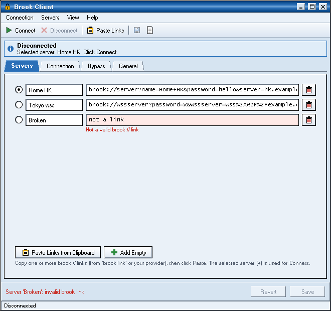
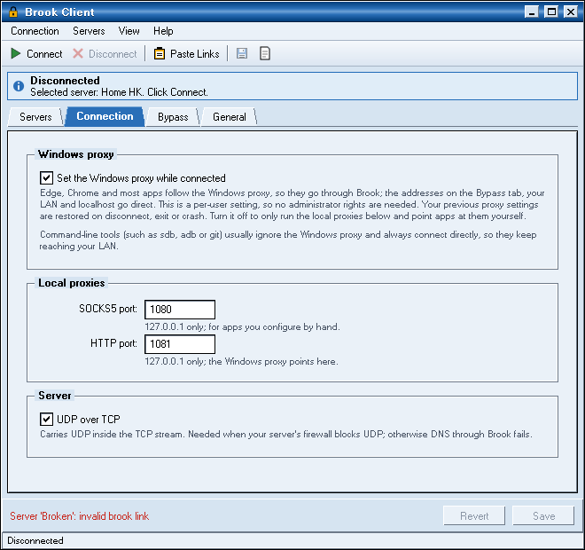

<p align="center"></p>

# Brook Client for Windows

A lightweight Windows notification-area client for [Brook](https://github.com/txthinking/brook) that **keeps your home network (LAN) outside the proxy**, so LAN tools such as Samsung's `sdb` can reach your TV while you are connected. It is the Windows port of the [macOS Brook Client](https://github.com/owen800q/brook-client), with a classic retro UI built on [Retro.NET](https://www.nuget.org/packages/Retro.NET).

**It runs without administrator rights.** There is no installer, driver, service or UAC prompt. Everything it changes belongs to your own user account.

<p align="center"> </p>

## How it works

| Destination | Route |
|---|---|
| Apps that follow the Windows proxy (Edge, Chrome, Firefox's default, most apps) | Windows proxy → `brook connect` (local HTTP proxy) → your Brook server |
| Bypass list (default `10/8`, `172.16/12`, `192.168/16`, `169.254/16`, `224/4`), `localhost`, `*.local`, dot-less names | direct, **never Brook** |
| Command-line tools (`sdb`, `adb`, `git`, `curl`, ...) | direct (they ignore the Windows proxy), so the LAN keeps working |
| Apps you point at it yourself | SOCKS5 `127.0.0.1:1080` or HTTP `127.0.0.1:1081` |

While connected, Brook Client writes your **per-user** proxy settings (`HKCU\Software\Microsoft\Windows\CurrentVersion\Internet Settings`) and tells running apps that they changed. Your previous settings are saved first and restored when you disconnect or exit. They are also restored if the app crashes or is killed from Task Manager: a small watchdog copy of the app does it, or the next launch does. `brook.exe` runs as your user, listens only on `127.0.0.1`, and is tied to the app through a job object, so it never outlives the app.

### Why no "full device" (TUN) mode like on macOS?

Creating a virtual network adapter (TUN/Wintun) and changing routes on Windows requires administrator rights. This port is designed to work for users without admin rights, so it uses the per-user system proxy instead. Because only proxy-aware apps use Brook, LAN devices are never captured by a tunnel in the first place. That was the original reason for the macOS client.

## Download

Get `BrookClient-<version>-windows-x64.zip` (or `-arm64`) from [Releases](https://github.com/owen800q/brook-client-window/releases). A new release is published for every commit to `main`, versioned `YYYY.MMDD.<build number>`.

1. Unzip it anywhere you can write to, for example `Downloads` or `%LOCALAPPDATA%\Programs\BrookClient`. Keep `BrookClient.exe` and `brook.exe` together.
2. Run `BrookClient.exe`. The app is not code-signed, so SmartScreen may warn you the first time. Click **More info → Run anyway**; this does not need admin rights.

Windows 10 or 11 is required. The exe is self-contained, so you don't need to install .NET.

## Use

1. **Disconnect any other VPN or proxy app.** Brook Client saves and restores whatever proxy settings were there before.
2. Copy your `brook://…` link (one or several), then click **Paste Links** (Servers tab).
3. Click **Save**, then **Connect** in the toolbar or from the shield icon in the notification area.
4. Check it:
   ```powershell
   curl.exe https://ipinfo.io/ip                          # direct: your own IP (CLI tools are not proxied)
   curl.exe -x http://127.0.0.1:1081 https://ipinfo.io/ip  # through Brook: your server's IP
   sdb connect <tv-ip>                                     # works: LAN is never proxied
   ```
   In a browser, https://ipinfo.io shows your Brook server's IP.

Closing the window keeps Brook Client running in the notification area. Left-click the shield to open the window; right-click it for Connect/Disconnect, server switching, the log and Exit. The icon is grey when disconnected, colored when connected, has an amber dot while connecting and a red dot on errors.

Settings:
- **Servers**: name and link per server; ● picks the one used for Connect. Supported link kinds: `server`, `wsserver`, `wssserver`, `quicserver`. (`socks5` links can't be used with `brook connect`.)
- **Connection**: set the Windows proxy (on by default) or only run the local proxies; SOCKS5/HTTP ports; UDP over TCP (needed when your server's firewall blocks UDP).
- **Bypass**: IPv4 addresses/CIDRs that always go direct. Windows matches them against the address typed in an app, so `http://192.168.0.10` is direct, and names without a dot (`http://nas`) are always direct.
- **General**: connect on start, start at sign-in (your own `HKCU\...\Run` entry, which starts hidden in the notification area), and file locations.

Brook Client also auto-reconnects if brook exits, with back-off, and when the server's domain starts resolving to a different address.

## Files

| What | Where |
|---|---|
| Settings (contains your links/passwords) | `%APPDATA%\BrookClient\config.json` (same format as the macOS client's, so you can copy it over) |
| brook output | `%LOCALAPPDATA%\BrookClient\brook.log` |
| Client diagnostics | `%LOCALAPPDATA%\BrookClient\client.log` |
| Saved proxy settings while connected | `%LOCALAPPDATA%\BrookClient\proxy-backup.json` |

Set the environment variable `BROOKCLIENT_DATA` to a folder to keep all of these there instead, for example on a USB stick.

### Uninstall

Exit Brook Client, untick **Start Brook Client when I sign in** first if you enabled it, then delete the unzipped folder, `%APPDATA%\BrookClient` and `%LOCALAPPDATA%\BrookClient`.

## Build & test

```powershell
scripts\fetch-brook.ps1                       # official brook (v20270101) → vendor\brook.exe
dotnet build BrookClient.sln
dotnet test tests\BrookCore.Tests             # links, CIDR → proxy bypass, config, proxy backup/restore (any OS)
dotnet test tests\BrookClient.WindowsTests    # Windows: UI snapshots, the real exe, live connection via brook
scripts\build.ps1 [-Arch arm64]               # build\BrookClient-<version>-windows-<arch>.zip
```

The projects also build on Linux and macOS (`EnableWindowsTargeting`), and `BrookCore.Tests` runs there. Set `SNAPSHOT_DIR` to keep the window screenshots that the Windows tests render. CI (`.github/workflows/ci.yml`) runs everything on `windows-latest` and uploads the screenshots and a package.

To regenerate the icons from `assets/AppIcon.png` (the macOS icon), run `python scripts/make-icons.py` with a Python that has Pillow.

### Layout

- `src/BrookCore`: pure, tested logic with no Windows dependency. It is a port of the macOS `BrookCore`: link parsing and IP pinning, CIDRs, config, plus the Windows proxy plan (CIDR → WinINet bypass wildcards) and the proxy backup/restore.
- `src/BrookClient`: the WPF app (Retro.NET theme): notification-area icon and menu, main window, and the engine that runs brook, health checks, reconnects and the crash watchdog.
- `tests/`: `BrookCore.Tests` (cross-platform) and `BrookClient.WindowsTests` (Windows only).

### Known limitations
- Only apps that honor the Windows proxy are routed through Brook, and UDP is not proxied for them.
- Bypass rules match the host text an app uses, not resolved addresses: a LAN device reached by a dotted name (`tv.home.arpa`) goes through the proxy; use its IP address instead. Dot-less names and `*.local` are always bypassed.
- The brook link (including its password) appears in `brook connect`'s process arguments, as with the brook CLI itself.
